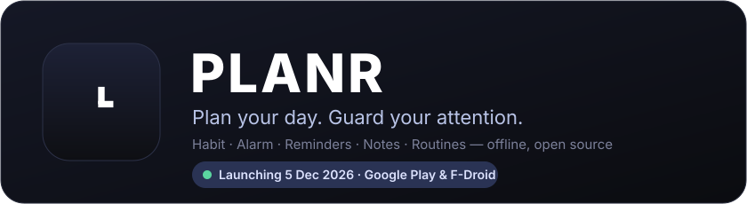

### Your day and your attention, in one offline Android app.
Alarms, reminders, notes, routines and screen-time habits, all on-device. Nothing is ever uploaded.

**🚀 Launching 5 December 2026 on Google Play and F-Droid**

Store pages go live on launch day. Until then, get the preview APK below.

[⬇️ Download preview APK](https://github.com/PATILYASHH/PLANR/releases) · [🐛 Report a bug](../../issues/new?template=bug_report.yml) · [✨ Request a feature](../../issues/new?template=feature_request.yml) · [🧪 ExoSynk Labs](https://exosynk.com/exosynk-labs)

> **Habits and plans, together.** Most planners just remind you. PLANR also
> protects the time you planned: a mindful pause before distracting apps,
> focus blocks, and **Off-Grid Mode**, which locks the whole phone down to calls,
> camera and a few apps you choose. Everything stays offline, with no
> `INTERNET` permission at all.

## Highlights

- 📅 **Today**: a week/month calendar of your reminders, notes and alarms, the day's agenda, and quick actions
- ✨ **Smart input**: type "*call to Parth at 9 am*" or "*wake me at 6:30 weekdays*". PLANR finds the time, the repeat and the contact, and adds a one-tap **Call / Message / WhatsApp** button
- ⏰ **Alarm**: Samsung-style alarm groups, skip next, fade-in volume, vibration patterns, snooze rules, read-aloud, math-to-dismiss, and a **morning brief**. It rings full screen and wakes the display, even during Off-Grid
- ✅ **Reminders**: date, all-day or anytime; repeats; early alerts; coloured categories; alarm-style alerts for the important ones
- 📝 **Notes**: text and checklists, colours, pin, archive, search, linked reminders, and quick notes from the Off-Grid lock screen
- 🔁 **Routines**: *if this, then that* with **undo when it ends**. Time windows, alarm dismissed, charging, headphones, an app opened → DND, sound mode, Focus, Off-Grid, alarm groups…
- 🌙 **Off-Grid Mode**: lock the phone for 15 min – 24 h. Calls always work, and it survives reboots. Early unlock means a typing, cooldown or math challenge
- 🛡️ **Shields & Mindful Gateway**: a breathing pause, daily time and open limits, emergency passes, and Lockdown hours when rules can only get stricter
- 🎯 **Focus**, 🛏️ **Wind Down**, 👀 **Eye Care 20-20-20**, 📊 **Insights** (heatmap, per-app history), 🏆 **XP & achievements**, 📱 **widget**
- 💾 **Backup & restore** of everything to a JSON file you control

Every feature, module by module: [docs/FEATURES.md](docs/FEATURES.md) · What's new: [CHANGELOG.md](CHANGELOG.md) · What's next: [ROADMAP.md](ROADMAP.md)

## Download

**Google Play** (launching **5 December 2026**): the easiest install, with automatic updates.

**F-Droid** (launching **5 December 2026**): auto-updates too, and F-Droid builds the app **from this source** itself.

**Right now:** grab the preview APK from [Releases](https://github.com/PATILYASHH/PLANR/releases) (Android 11+). Every release ships `SHA256SUMS.txt`.

> **Preview builds before launch are signed with a temporary key**, so they won't update in place.
> **Settings → Backup & restore → Export**, uninstall, install the new build, then restore.
> The same applies when you switch between Google Play, F-Droid and a direct APK: each is signed differently.

**First run:** open PLANR → **Habit → Finish setup** (Accessibility + Usage access), then **Alarm → Alarm setup** → tap *Allow* on each item, and try **Test alarm**.

## Privacy

No `INTERNET` permission, no accounts, no ads, no analytics. Everything lives in PLANR's private on-device database. The Accessibility service only sees which app is in front, never what's on screen or what you type. Contacts are read on-device, and only after you allow it.
[PRIVACY.md](PRIVACY.md) · [SECURITY.md](SECURITY.md)

## Contributing

Contributions are welcome: bug reports, ideas, translations and pull requests.

📖 [CONTRIBUTING.md](CONTRIBUTING.md) (setup & PR checklist) · 🛠️ [docs/DEVELOPMENT.md](docs/DEVELOPMENT.md) (build, release, architecture) · 🔗 [docs/exosynk-link.md](docs/exosynk-link.md) (connecting XPENC, FITNS & CONECTR)

## More from ExoSynk Labs

PLANR is part of an open-source family of offline-first apps: **[XPENC](https://github.com/PATILYASHH/XPENC)** (money, tracked honestly), **[FITNS](https://github.com/PATILYASHH/FITNS)** (fitness tracking) and **CONECTR** (backup and sync for the family). See them all at **[exosynk.com/exosynk-labs](https://exosynk.com/exosynk-labs)**.

## Sponsor

PLANR is free, open source, and has no ads, trackers or paid tier.

Can't sponsor? A ⭐, a bug report or a feature idea helps just as much.

---

**[Apache 2.0](LICENSE) © 2026 ExoSynk Labs** · Credits in [NOTICE](NOTICE) · GitHub [@PATILYASHH](https://github.com/PATILYASHH)

If PLANR gives you back an hour a day, a ⭐ keeps the project alive.

